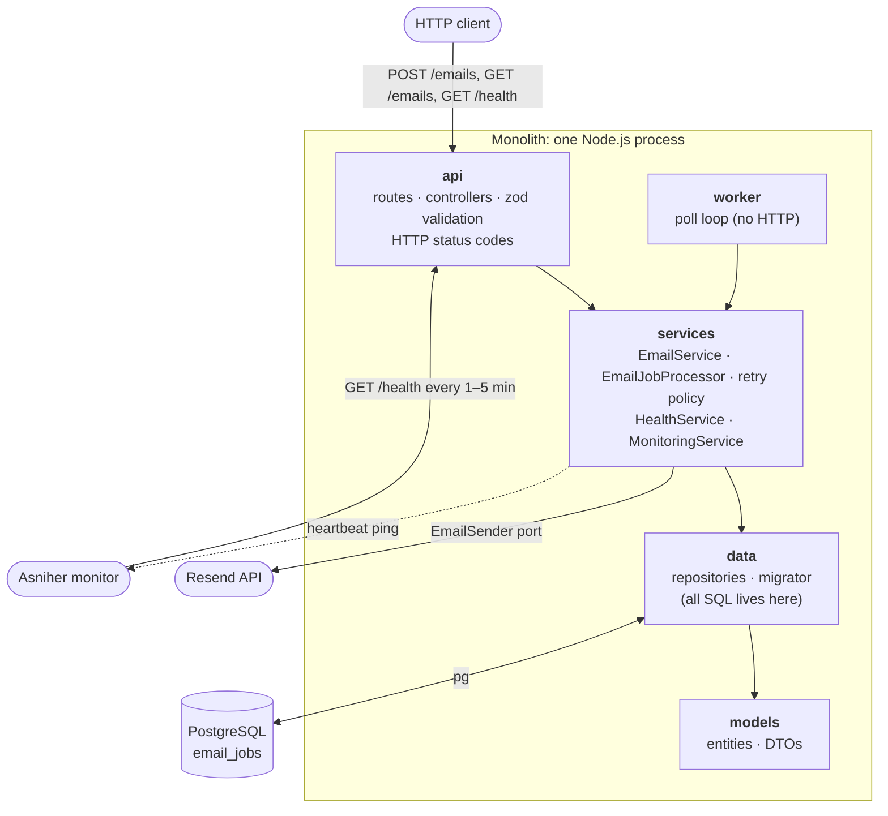
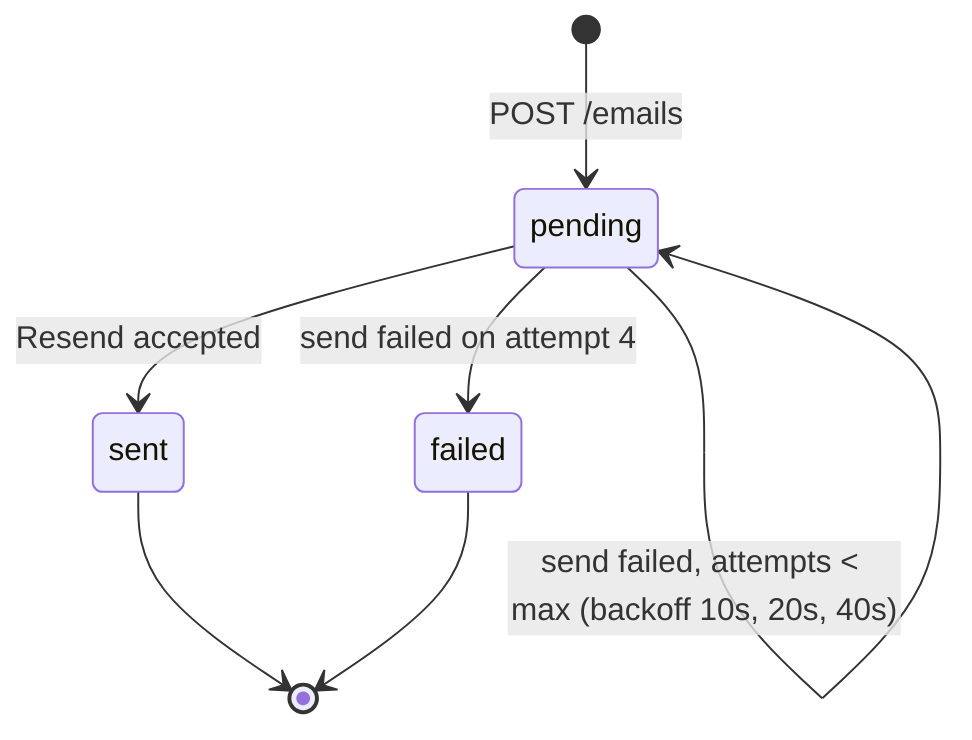

# Mail Queue Service

A small monolithic Node.js + TypeScript backend that sends emails **through a queue**:

- `POST /emails` validates the request, stores a `pending` job in **PostgreSQL** and returns `202` right away. It never calls the email provider itself.
- A **background worker** claims due jobs, sends them via **[Resend](https://resend.com)**, and records the outcome (`sent` / `failed`). Failures are **retried 3 times** with exponential backoff before a job is marked `failed`.
- `GET /health` reports app and database status (`200` / `503`) and is monitored in production on **[Asniher](https://asniher.com)**.

> Live URL: `https://<your-service>.onrender.com` (fill in after deploying, see [Deployment](#deployment))

---

## Architecture



| Layer | Folder | Responsibility | Not allowed |
|---|---|---|---|
| api | `src/api` | Routes, controllers, request validation (zod), HTTP responses, error → status mapping | SQL, `pg`, business rules |
| services | `src/services` | Business logic: enqueue, job processing, retries, health, heartbeat; external providers behind ports | `express`, status codes, SQL |
| data | `src/data` | `pg` pool, repositories, migration runner. **Only place with SQL** | Business rules, HTTP |
| models | `src/models` | Entities and DTOs (types only) | Any I/O |

`src/worker` is a second entrypoint at the same level as `api` and only calls services. `src/container.ts` is the composition root that wires the layers together.

The rules are **enforced**: `npm run lint:arch` runs [dependency-cruiser](.dependency-cruiser.cjs) (fails on any upward or layer-skipping import, or on `pg`/`express`/`resend` used in the wrong layer) and [a check](scripts/check-no-sql.mjs) that fails if SQL appears outside `src/data`. Both run in CI.

### Email job lifecycle



- Jobs are claimed with `UPDATE … WHERE id IN (SELECT … FOR UPDATE SKIP LOCKED)`, so several workers never pick the same job.
- A claimed job gets a lease (`locked_until`). If the process crashes mid-send, the lease expires and the job is picked up again.
- The job id is sent to Resend as the **idempotency key**, so a retry after a crash can't send a duplicate.
- Details: [docs/SPEC.md](docs/SPEC.md).

---

## Local setup

Requirements: Node.js ≥ 22, Docker.

```bash
git clone https://github.com/<you>/infotech_task_one.git
cd infotech_task_one
npm install

docker compose up -d          # Postgres 16 on :5432 (+ a mailqueue_test DB for tests)
cp .env.example .env          # then set RESEND_API_KEY and API_KEY

npm run migrate:up            # create tables
npm run seed                  # sample jobs in every status (safe to run twice)
npm run dev                   # API + worker on http://localhost:3000
```

### Scripts

| Script | What it does |
|---|---|
| `npm run dev` | API + in-process worker with auto-reload |
| `npm run dev:worker` | Worker only |
| `npm run migrate:up` / `migrate:down` | Apply all pending migrations / revert the last one |
| `npm run seed` | Insert sample jobs (idempotent) |
| `npm test` | Unit + API + integration tests (integration tests need the Docker Postgres) |
| `npm run lint` · `lint:arch` · `typecheck` | ESLint · layer rules + SQL check · TypeScript |
| `npm run build` · `npm start` | Compile, then migrate + start (production) |

---

## Environment variables

All configuration comes from the environment (validated at startup in [src/config/env.ts](src/config/env.ts)). See [.env.example](.env.example).

| Variable | Required | Default | Description |
|---|---|---|---|
| `NODE_ENV` | no | `development` | `development` / `test` / `production` |
| `PORT` | no | `3000` | HTTP port |
| `LOG_LEVEL` | no | `info` | pino log level |
| `DATABASE_URL` | yes* | — | Postgres connection string. *Or use the `PG*` variables below |
| `PGHOST` `PGPORT` `PGUSER` `PGPASSWORD` `PGDATABASE` | yes* | — | Used when `DATABASE_URL` is not set |
| `DATABASE_SSL` | no | `false` | Enable TLS to Postgres |
| `DATABASE_POOL_MAX` | no | `10` | Pool size |
| `RESEND_API_KEY` | for worker | — | Resend API key |
| `EMAIL_FROM` | no | `onboarding@resend.dev` | Sender address |
| `API_KEY` | yes | — | Shared secret required in the `x-api-key` header for `/emails*` |
| `WORKER_ENABLED` | no | `true` | Run the worker inside the API process |
| `WORKER_POLL_INTERVAL_MS` | no | `2000` | Poll interval when the queue is empty |
| `WORKER_BATCH_SIZE` | no | `10` | Jobs claimed per poll |
| `WORKER_LOCK_SECONDS` | no | `60` | Lease length for a claimed job |
| `EMAIL_MAX_ATTEMPTS` | no | `4` | Total attempts; must be ≥ 4 (1 send + at least 3 retries) |
| `EMAIL_RETRY_BASE_MS` | no | `10000` | Backoff base (doubles each attempt, ±20% jitter) |
| `ASNIHER_HEARTBEAT_URL` | no | — | Asniher heartbeat URL the worker pings; disabled if empty |
| `HEARTBEAT_INTERVAL_MS` | no | `60000` | Minimum time between heartbeat pings |

> Without a verified domain, Resend only allows sending from `onboarding@resend.dev` to your own account email or Resend's test inboxes (`delivered@resend.dev`, `bounced@resend.dev`).

---

## API & example requests

All `/emails*` endpoints need `x-api-key: $API_KEY`. `/health` is public.

```bash
BASE=http://localhost:3000
KEY=your-api-key
```

### Enqueue an email: `POST /emails`

```bash
curl -i -X POST $BASE/emails \
  -H "x-api-key: $KEY" -H "content-type: application/json" \
  -d '{
        "to": "delivered@resend.dev",
        "subject": "Welcome!",
        "html": "<p>Hello from the queue</p>",
        "text": "Hello from the queue",
        "idempotencyKey": "welcome-42"
      }'
```

```http
HTTP/1.1 202 Accepted

{
  "id": "1aa47640-5366-4c72-90a4-c9d74f477c42",
  "to": "delivered@resend.dev",
  "subject": "Welcome!",
  "status": "pending",
  "attempts": 0,
  "maxAttempts": 4,
  "lastError": null,
  "providerMessageId": null,
  "nextAttemptAt": "2026-10-31T16:46:05.579Z",
  "sentAt": null,
  "createdAt": "2026-10-31T16:46:05.579Z",
  "updatedAt": "2026-10-31T16:46:05.579Z"
}
```

Sending the same `idempotencyKey` again returns the original job with `200`. Validation errors return `400`:

```json
{ "error": { "code": "VALIDATION_ERROR", "message": "Request validation failed",
             "details": [{ "path": "to", "message": "Invalid email address" }] } }
```

### Check a job: `GET /emails/:id`

```bash
curl -s $BASE/emails/1aa47640-5366-4c72-90a4-c9d74f477c42 -H "x-api-key: $KEY"
```

After the worker has run, `status` is `sent` with a `providerMessageId`. If all attempts fail, it is `failed` with `attempts: 4` and the `lastError`.

### List jobs: `GET /emails?status=&limit=&offset=`

```bash
curl -s "$BASE/emails?status=failed&limit=20&offset=0" -H "x-api-key: $KEY"
```

### Health: `GET /health`

```bash
curl -i $BASE/health
```

```json
HTTP/1.1 200 OK
{ "status": "ok", "timestamp": "2026-10-31T16:46:22.299Z",
  "app": { "status": "up", "version": "1.0.0", "uptimeSeconds": 17 },
  "database": { "status": "up", "latencyMs": 1 } }
```

```json
HTTP/1.1 503 Service Unavailable
{ "status": "error", "timestamp": "2026-10-31T16:46:18.726Z",
  "app": { "status": "up", "version": "1.0.0", "uptimeSeconds": 14 },
  "database": { "status": "down", "error": "unreachable" } }
```

---

## Deployment

The repo includes a [Render Blueprint](render.yaml): a free web service (API + in-process worker) and a free Postgres database.

1. On Render: **New → Blueprint** → select this repository.
2. When prompted, enter `RESEND_API_KEY` (and later `ASNIHER_HEARTBEAT_URL`). `API_KEY` is generated for you; copy it from the service's Environment tab.
3. Deploy. `npm start` runs the migrations, then starts the server. Render's own health check uses `/health`.
4. Optional seed: open the service **Shell** and run `node dist/scripts/seed.js`.

Free-tier notes: free web services sleep when idle (the Asniher checks keep the service awake), and free Render Postgres databases expire after a limited time.

---

## Monitoring (Asniher)

| Monitor | Type | Target |
|---|---|---|
| API health | HTTP(S) | `GET https://<service>.onrender.com/health`, expects `2xx`, every 1–5 min |
| Health payload | Keyword | Same URL, must contain `"database":{"status":"up"` |
| Worker alive | Heartbeat | The worker pings `ASNIHER_HEARTBEAT_URL` at most once a minute |


<!-- Add docs/monitoring/asniher-monitor.png after creating the monitor (see docs/BACKLOG.md T6.4–T6.7). -->

---

## Project layout

```
src/
  api/          routes, controllers, validators, presenters, middleware
  services/     business logic, retry policy, ports/ (interfaces), providers/ (Resend, Asniher)
  data/         db pool, repositories, migrator
  models/       entities and DTOs
  worker/       poll loop
  config/       env validation, logger
  container.ts  composition root
  server.ts     API entrypoint (+ worker when WORKER_ENABLED)
  worker-main.ts  standalone worker entrypoint
migrations/     SQL up/down files
scripts/        migrate, seed, SQL layer check
tests/          unit, api (supertest), integration (real Postgres)
docs/           SPEC, FEATURES, BACKLOG
```
